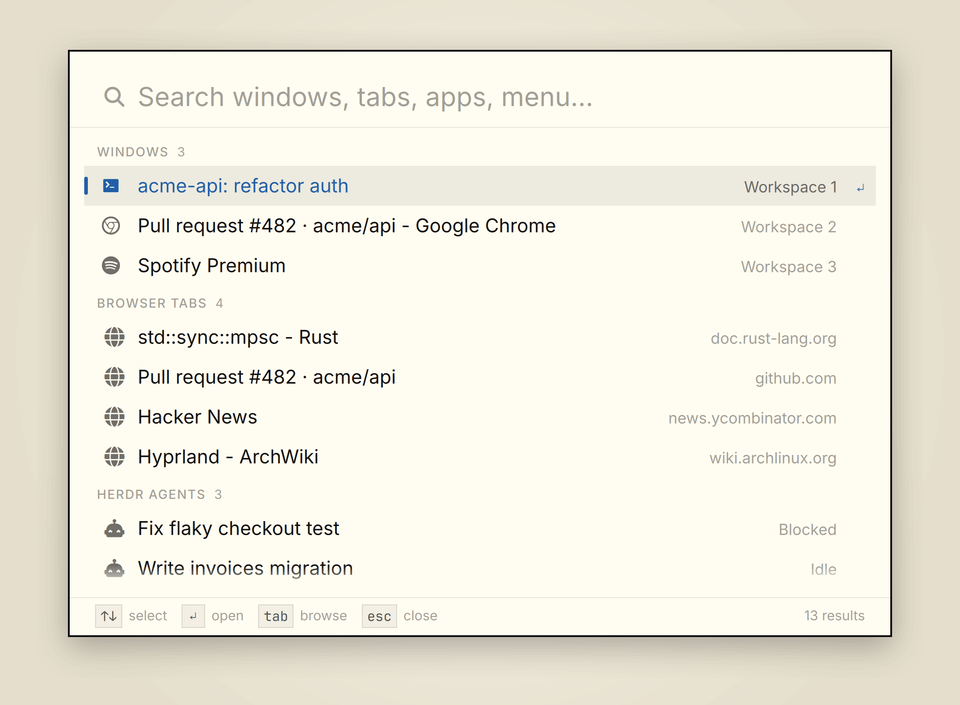
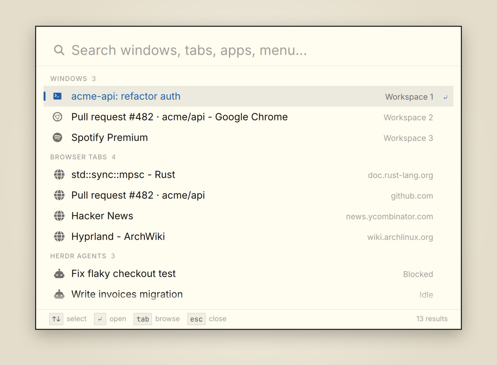
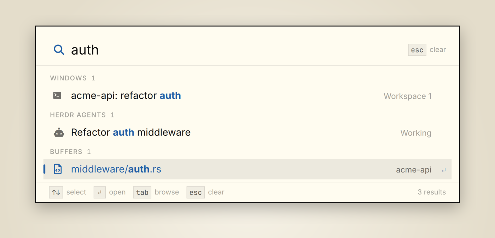
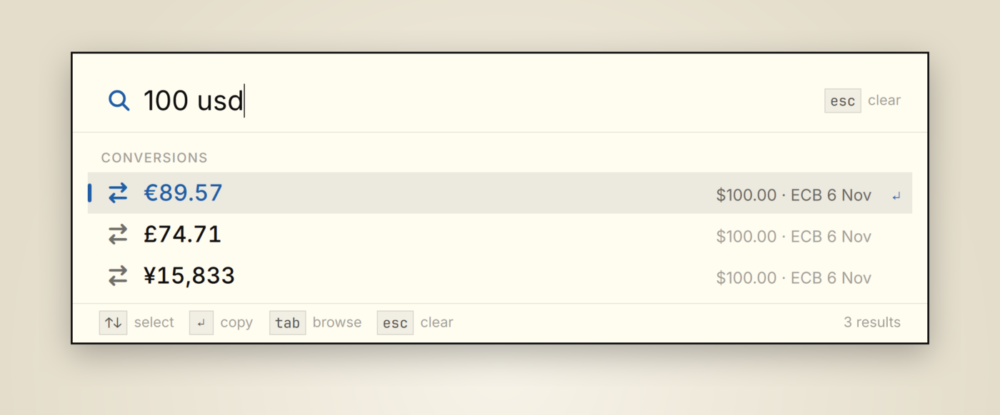
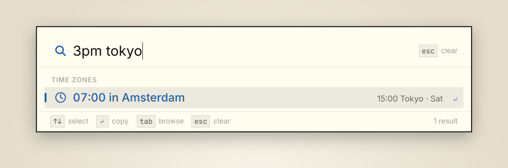
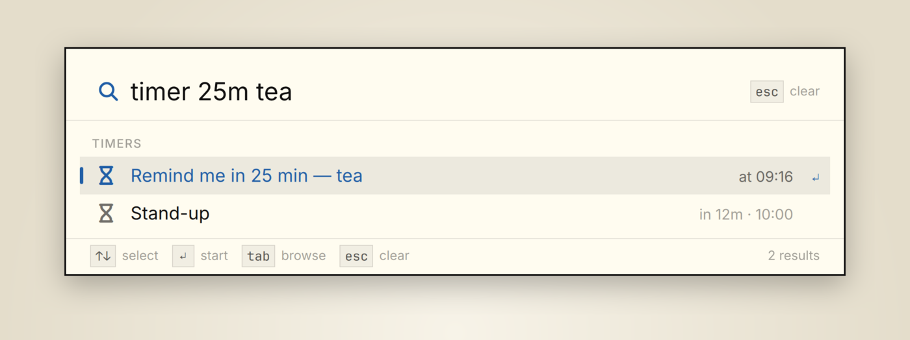
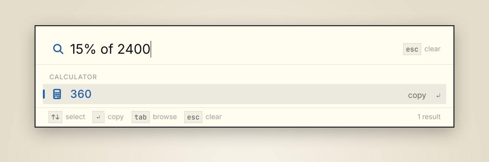
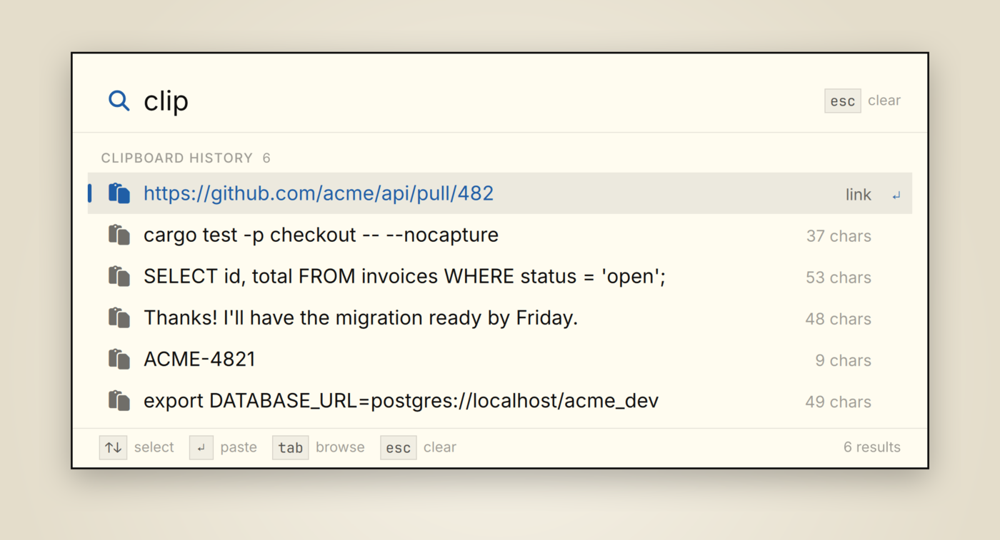
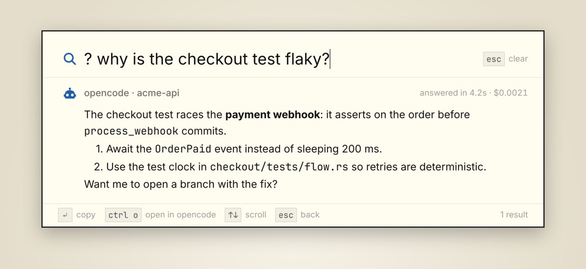
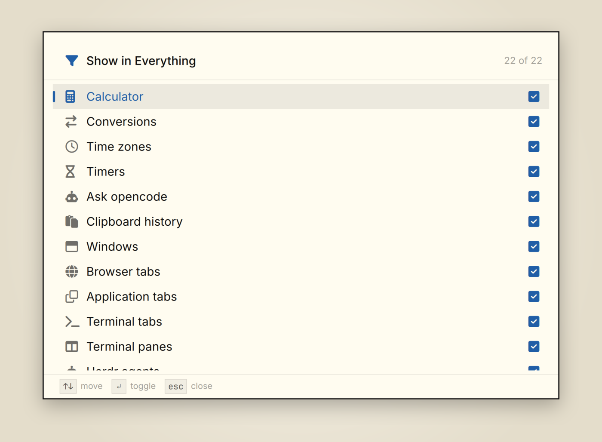

<div align="center">

# Everything

### <kbd>Super</kbd> + <kbd>Space</kbd>. Type. You're there.

Every window, browser tab, terminal pane, editor buffer and AI agent on your desktop, in one list.<br>
Plus a calculator, currency and unit converter, world clock, timer, clipboard history and an AI agent,<br>
all in the same search box.

An [Omarchy](https://omarchy.org) plugin with a Rust engine that is ready in **~1 ms**.



</div>

---

## Stop hunting for windows

You have twelve windows on five workspaces, forty Chrome tabs and three agents running in a terminal multiplexer. *Which workspace was that PR on?*

Everything answers with one keystroke. It lists what is **already open**, and picking a result **jumps to it**: the exact window, the exact Chrome tab, the exact agent pane. It never launches a duplicate.

<p align="center">
  
  
</p>

- **Fuzzy, fzf-style.** `hck` finds *Hacker News*, `auth` finds the agent refactoring your auth middleware. The letters that matched light up.
- **<kbd>Enter</kbd> takes the highlighted hit.** The highlight is always visible, and <kbd>↑</kbd> <kbd>↓</kbd> move it while you keep typing.
- **Contextual.** The list leads with what fits where you were: Herdr agents when a terminal had focus, Chrome tabs when Chrome did, windows otherwise.
- **Looks like it belongs.** Same palette as the Omarchy menu, follows your theme, crisp on HiDPI.

## Type anything else, too

The search box is also a toolbox. Answers appear as the first row; <kbd>Enter</kbd> does the obvious thing.

| Type | You get | <kbd>Enter</kbd> |
|---|---|---|
| `15% of 2400`, `sqrt(2)*1e3`, `2^10` | **Calculator** with percentages, functions, hex and implicit multiply | copies the number |
| `100 usd`, `1.5k eur to jpy`, `rp 50rb in sgd` | **Currency**, at daily ECB rates | copies the amount |
| `5 km in mi`, `100 f to c`, `2 tb` | **Units**: length, weight, volume, temperature, data, speed and more | copies |
| `3pm tokyo`, `15:00 london to nyc`, `time in sydney` | **World clock** in your local time, with the day shift | copies the time |
| `timer 25m tea`, `remind me in 1h to stretch` | **Timer** via Omarchy reminders; `timers` lists and clears them | starts it |
| `clip`, `clip docker` | **Clipboard history**, images included as thumbnails | pastes it |
| `? why is the checkout test flaky` | **Ask an AI agent** ([opencode](https://opencode.ai)) in your project | copies the answer |

<p align="center">
  
  
  
  
</p>

### Clipboard history, searchable

`clip` shows everything you copied, newest first, images too. Type to filter, then <kbd>Enter</kbd> pastes it straight into the window you came from.



### Ask an agent without leaving the keyboard

Start with `?` and Everything runs [opencode](https://opencode.ai) in a project you choose. The answer lands in the panel a few seconds later, formatted.

- <kbd>Enter</kbd> copies the answer.
- <kbd>Ctrl</kbd>+<kbd>O</kbd> reopens the same conversation in opencode, so you can keep going.
- Closed the panel too early? The answer arrives as a notification.



## Install

```bash
omarchy plugin add https://github.com/adhikasp/omarchy-everything.git --enable --yes

# build the Rust helper (needs a Rust toolchain, ~10 s)
cd ~/.config/omarchy/plugins/io.github.adhikasp.everything/rust && cargo build --release

omarchy restart shell
```

Then make <kbd>Super</kbd>+<kbd>Space</kbd> open it. Add this to `~/.config/hypr/bindings.lua`:

```lua
hl.unbind("SUPER + SPACE")
hl.bind("SUPER + SPACE", hl.dsp.global("omarchy-everything:toggle"), { description = "Everything" })
```

That's it. The Omarchy menu stays one search away: type `setup`, `theme` or `update`.

**Optional extras:**
- [opencode](https://opencode.ai) for `?` questions.
- The [Inter](https://rsms.me/inter/) font (package `inter-font`): the panel uses it when installed, otherwise Noto Sans.
- A browser-tabs host for Chrome tab results. It is any process serving the local socket described in [providers](docs/providers.md); without one, Chrome appears only as its window.

## Fast, really

The helper that gathers everything is a small Rust binary (the original was Python). Median of 15 runs on a Ryzen 5 5560U:

| | Rust | Python before |
|---|---:|---:|
| Process start → ready | **1.3 ms** | 325 ms |
| Cold start → full scan | **17.5 ms** | 486 ms |
| Memory | **4 MB** | 37 MB |

Super+Space reaches the panel through a Hyprland global shortcut (about 12 ms, versus 55 ms for spawning `qs ipc`), and the helper stays warm for two minutes after you close it.

## What it finds

| Source | Finds | Picking it |
|---|---|---|
| Hyprland | Every window on every workspace | focuses the window |
| Chrome | Every tab (needs the optional tabs socket, see [providers](docs/providers.md)) | switches to the tab |
| Herdr | Sessions, workspaces, tabs, panes, agents | focuses the pane |
| tmux, Kitty | Sessions, windows, panes | focuses the pane |
| Neovim | Open buffers | jumps to the buffer |
| Apps, Omarchy menu | Installed apps and every menu action | launches it (shown once you type) |

Ghostty, Foot and Alacritty windows are listed as windows; the tabs and panes inside them are not enumerated.

## Make it yours

Right-click the bar icon to choose which groups appear. Every quick action can be switched off too.



Settings live in the plugin's entry in `~/.config/omarchy/shell.json`:

```json
{
  "id": "io.github.adhikasp.everything",
  "askWorkspace": "~/code/acme-api",
  "askModel": "provider/model-id",
  "currencies": ["EUR", "GBP", "JPY"]
}
```

- `askWorkspace`: the folder `?` questions run in. Default: home.
- `askModel`: optional; otherwise opencode's default model.
- `currencies`: what a bare `100 usd` converts into. Default: USD and EUR.

## Keyboard

| Keys | Does |
|---|---|
| type | search, or start a quick action |
| <kbd>↑</kbd> <kbd>↓</kbd>, <kbd>Ctrl</kbd>+<kbd>N</kbd> <kbd>P</kbd>, <kbd>PgUp</kbd> <kbd>PgDn</kbd> | move the highlight while typing |
| <kbd>Enter</kbd> | open, copy, paste or ask, depending on the row |
| <kbd>Tab</kbd> | browse mode: vim keys, <kbd>←</kbd> <kbd>→</kbd> to fold groups, <kbd>Del</kbd> to hide a row, <kbd>/</kbd> to search again |
| <kbd>Ctrl</kbd>+<kbd>O</kbd> | on an answer: open the conversation in opencode |
| <kbd>Esc</kbd> | clear the search, then close |

The footer always shows the keys that work right now.

## Private by default

- Everything runs locally. The **only** network request is the daily exchange-rate file from the ECB (via [frankfurter.dev](https://frankfurter.dev)), fetched only when you type a currency, cached, and carrying no data about you.
- The calculator is a small parser, not `eval`. Titles, clipboard entries and agent output are rendered as plain text or sanitised Markdown, so a malicious tab title can't inject markup.
- Your text reaches commands as arguments, never spliced into a shell string.

Details: [security](docs/security.md), [instant answers](docs/instant-answers.md).

## Under the hood

A QML panel talks to the Rust helper over a small versioned JSON-lines protocol. Quick actions are pure functions in [`InstantAnswers.js`](InstantAnswers.js), unit tested with fixed rates, clocks and hostile input.

```sh
tests/all.sh                  # Rust, model and QML tests
python3 rust/tools/bench.py   # cold start and scan timings
demo/record.sh                # regenerate the README media from fictional data
```

More in [`docs/`](docs): [architecture](docs/architecture.md), [protocol](docs/protocol.md), [providers](docs/providers.md), [instant answers](docs/instant-answers.md), [security](docs/security.md), [testing](docs/testing.md). Kitty support is ported but untested here.

## Update and uninstall

```bash
omarchy plugin update io.github.adhikasp.everything   # then rebuild rust/ if the source changed
omarchy plugin remove io.github.adhikasp.everything
```

Removal deletes the plugin folder. Also delete the plugin's entry from `~/.config/omarchy/shell.json`, the `SUPER + SPACE` bind from `~/.config/hypr/bindings.lua` (restore Omarchy's default with `hl.bind("SUPER + SPACE", ...)` if you want it back), and the cached rates file `~/.cache/omarchy-everything-rates.json`.

## Credits

Originally forked from [`brianblakely/omarchy-everything`](https://github.com/brianblakely/omarchy-everything) by Brian Blakely, whose original concept and provider code this builds on. This is a separate plugin with its own ID, so both can be installed. It adds the Rust helper, fuzzy search, the redesigned panel and the quick actions. MIT licensed.

<sub>All screenshots and the GIF are rendered by `demo/record.sh` from fictional data, not a real desktop.</sub>
