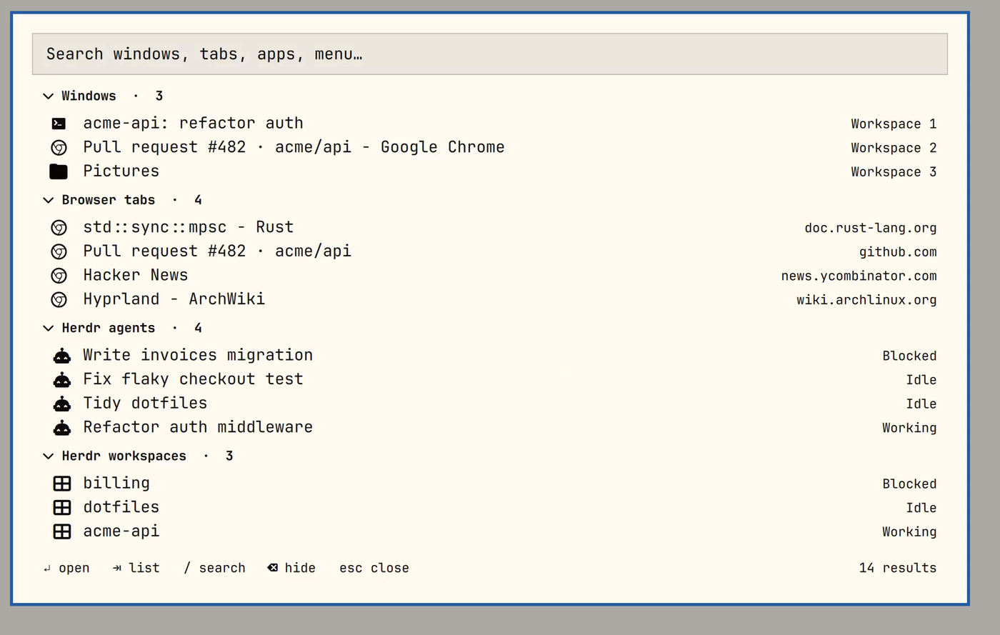
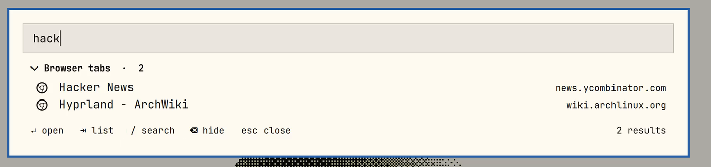
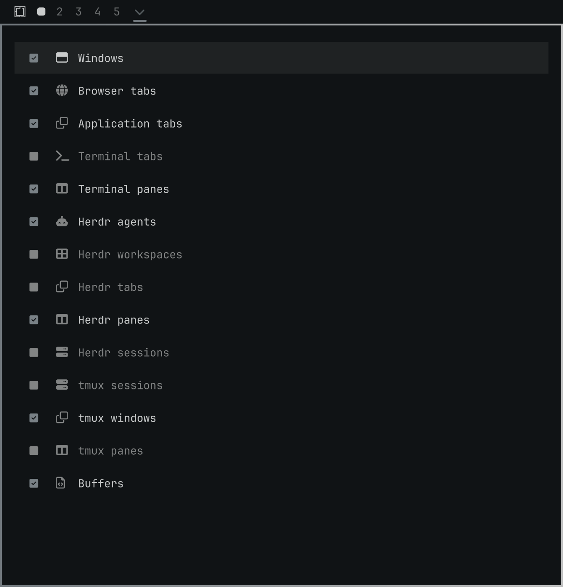

<div align="center">

# Everything

**One keystroke. Every window, tab, terminal, editor buffer and AI agent on your desktop.**<br>
Type a few letters, hit <kbd>Enter</kbd>, and you're there.

An [Omarchy](https://omarchy.org) plugin, now with a Rust engine that starts in **~1 ms**.


</div>

---

## Why you'll like it

- **Everything in one list.** Windows, Chrome tabs, Herdr workspaces and agents, tmux, Kitty, Neovim buffers, apps and the Omarchy menu. No more *"which workspace was that on?"*
- **Jump, don't launch.** Picking a result focuses the exact window, switches to the exact tab, or lands on the exact agent pane. It never opens a duplicate.
- **Fuzzy and fast.** fzf-style matching, so `hck` finds *Hacker News* and `auth` finds the agent refactoring your auth middleware. <kbd>Enter</kbd> takes the top hit.
- **Keyboard first.** Vim keys, <kbd>Ctrl</kbd>+<kbd>N</kbd>/<kbd>P</kbd>, <kbd>/</kbd> to search, <kbd>X</kbd> to hide noise.
- **Feels native.** A 45 ms fade, centered card, and the Omarchy theme.

<p align="center">
  
  &nbsp;
  
</p>

## Fast

The helper that gathers everything is a small Rust binary. The original Python helper took 325 ms to start and 486 ms for a cold scan, and used 37 MB. Numbers from this fork, median of 15 runs on a Ryzen 5 5560U:

| | |
|---|---:|
| Process start → ready | **1.3 ms** |
| Cold start → full scan | **17.5 ms** |
| Warm full scan | **15 ms** |
| Memory (RSS) | **4 MB** |

Super+Space reaches the panel through a Hyprland global shortcut instead of spawning `qs ipc`, which is about 12 ms rather than 55 ms. The helper stays warm for two minutes after you close the panel, so reopening is instant.

## Install

This is a fork of [`brianblakely/omarchy-everything`](https://github.com/brianblakely/omarchy-everything) that adds the Rust helper, fuzzy search and a faster open path.

```bash
omarchy plugin add https://github.com/adhikasp/omarchy-everything.git --enable --yes

# build the Rust helper (needs a Rust toolchain; ~10 s)
cd ~/.config/omarchy/plugins/b.everything/rust && cargo build --release

omarchy restart shell
```

The build step is required: the plugin has no other helper.

## Open it

Click the arrow in the bar, or bind a key. For the fastest open, use the global shortcut in `~/.config/hypr/bindings.lua`:

```lua
hl.unbind("SUPER + SPACE")
hl.bind("SUPER + SPACE", hl.dsp.global("omarchy-everything:toggle"), { description = "Everything" })
```

Prefer the stock route? This works too, just a few tens of ms slower:

```lua
o.bind("SUPER + SPACE", "Everything", "omarchy-shell shell toggle b.everything")
```

## What it finds

| Source | Finds | Activation |
|---|---|---|
| Hyprland | Every window, on every workspace | Focus the window |
| Chrome | Every tab (via the Screen Context extension) | Switch to the tab |
| Herdr | Sessions, workspaces, tabs, panes, agents | Focus the pane |
| tmux, Kitty | Sessions, windows, panes | Focus the pane |
| Neovim | Open buffers | Jump to the buffer |
| Apps, Omarchy menu | Installed apps and menu entries | Search-only, launched on match |

## Configure

Right-click the bar icon to choose which groups appear.



Ghostty, Foot and Alacritty windows are listed as ordinary windows. Tabs and panes inside them are not enumerated.

## Keyboard

| Keys | Action |
|---|---|
| <kbd>J</kbd> <kbd>K</kbd> / <kbd>↓</kbd> <kbd>↑</kbd>, <kbd>Ctrl</kbd>+<kbd>N</kbd> <kbd>P</kbd> | Move through results |
| <kbd>H</kbd> <kbd>L</kbd> / <kbd>←</kbd> <kbd>→</kbd> | Collapse or expand a group |
| <kbd>g</kbd> <kbd>G</kbd>, <kbd>Home</kbd> <kbd>End</kbd> | Top or bottom |
| <kbd>Ctrl</kbd>+<kbd>U</kbd> <kbd>D</kbd>, <kbd>PgUp</kbd> <kbd>PgDn</kbd> | Page up or down |
| <kbd>Enter</kbd> | Activate the highlighted result (the top hit while searching) |
| <kbd>/</kbd>, <kbd>Tab</kbd> | Focus search, or switch between search and list |
| <kbd>X</kbd>, <kbd>Backspace</kbd>, <kbd>Delete</kbd> | Hide the highlighted result until restart |
| <kbd>Esc</kbd> | Clear the search, then close |

## Under the hood

The QML UI talks to a Rust helper over a small versioned JSON-lines protocol. Hyprland, Chrome, Herdr, Kitty, tmux and Neovim are read natively in Rust, with no runtime other than the binary itself.

```sh
cd rust && cargo build --release
python3 rust/tools/bench.py    # cold start and scan timings
```

More in [`docs/`](docs): [architecture](docs/architecture.md), [protocol](docs/protocol.md), [providers](docs/providers.md), [security](docs/security.md), [testing](docs/testing.md). Kitty support is ported but untested here, because Kitty isn't installed on the dev machine.

## Update and uninstall

```bash
omarchy plugin update b.everything   # then rebuild rust/ if the source changed
omarchy plugin remove b.everything
```

## Credits

Built on [`brianblakely/omarchy-everything`](https://github.com/brianblakely/omarchy-everything). MIT licensed.

<sub>The screenshots and GIF use fictional demo data, not a real desktop.</sub>
